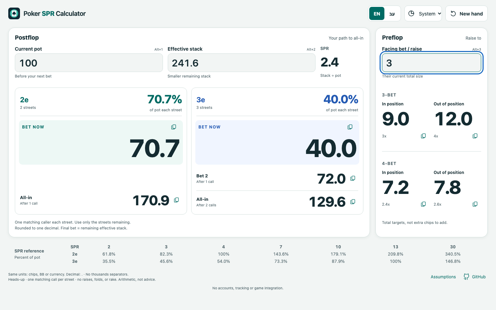
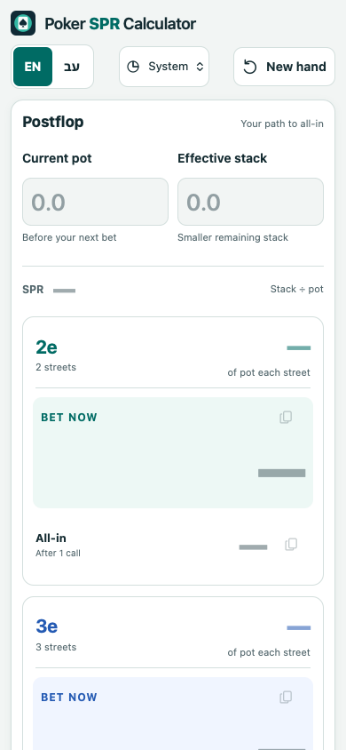
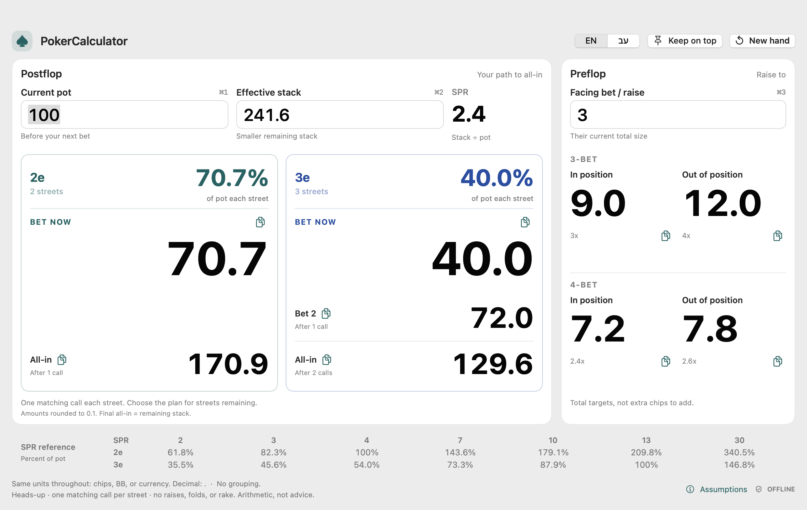
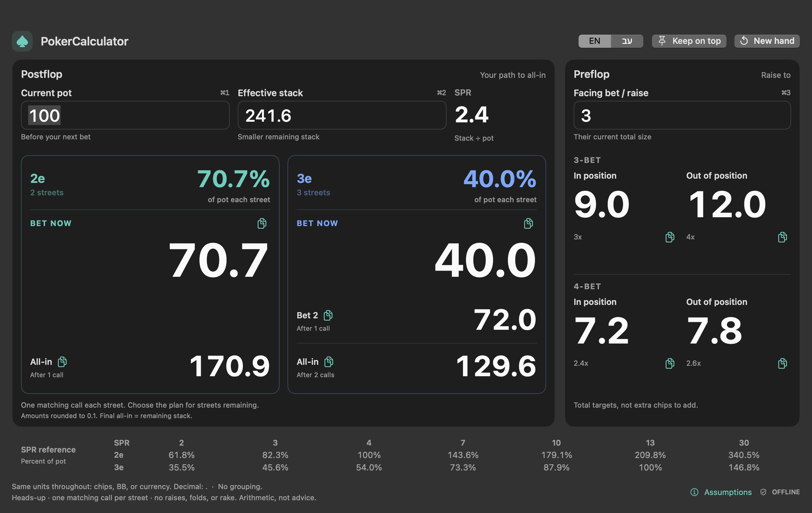
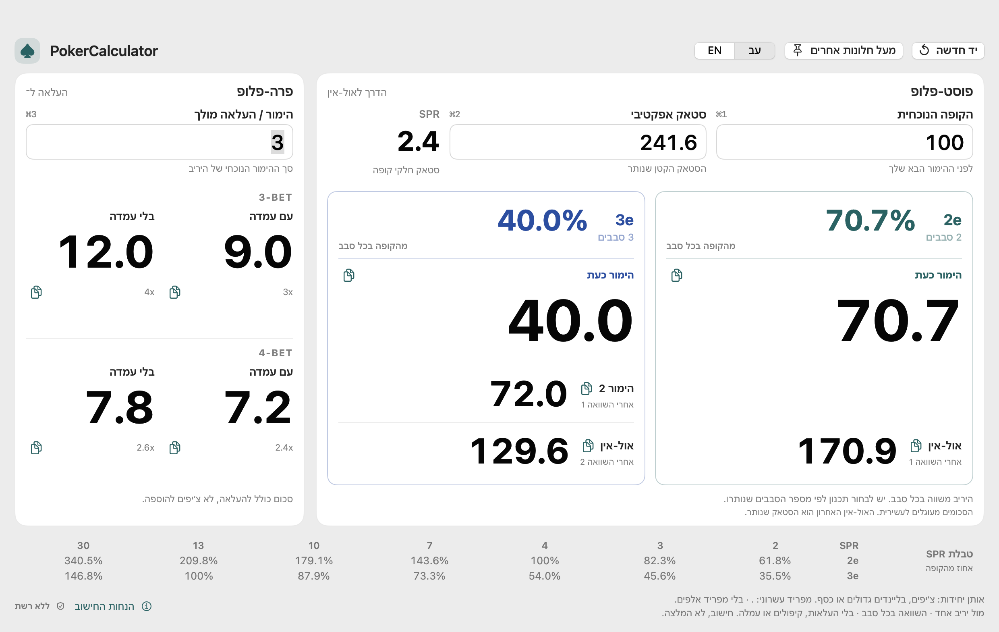

# Poker SPR Calculator

**Web app:** [poker-spr-calculator.magalhoresh.com](https://poker-spr-calculator.magalhoresh.com/)

A fast-glance poker arithmetic calculator for desktop and mobile: current pot,
effective stack, live SPR, complete two/three-street paths to all-in, and all four
preflop raise-to targets. **English / Hebrew** and **System / Light / Dark**
controls are always available. The source repository is public:
[`MagalHoresh/PokerSPRCalculator`](https://github.com/MagalHoresh/PokerSPRCalculator).
Anyone can read the code without signing in. Calculations remain private on
your device.

This repository starts with a clean, tested source snapshot; older development
history is not included. No new software license is granted by publication.

Everything calculates on the device, without a backend, accounts, tracking,
game integration or sending/storing hand inputs. The page loads static assets
over HTTPS; arithmetic works without further network requests once loaded.
The language resets to English on each page load. Theme/language choices are
tab-local, and clearing a hand preserves those choices.

On mobile, **current pot and effective stack appear first**, without an autofocus
keyboard. The full paths follow, then the independent preflop calculator and
reference. Mobile intentionally scrolls vertically; desktop keeps the main
calculators together. Numbers and copied values use one decimal place, and the
full-precision math matches the native applications.

## Web development

```sh
npm --prefix web ci
npm --prefix web run build
npm --prefix web test
npm --prefix web start
```

Open the printed loopback URL. Browser checks:

```sh
cd web
npx playwright install chromium webkit
npm run test:ui
```

The runtime has no framework, external font, CDN dependency or third-party
JavaScript. Node 22+ is a build/test tool only. Build output is an explicit
allowlist in `web/dist`; native binaries, screenshots, tests, deployment-session
files and repository history are not published.

**Web controls:** Alt+1/2/3 focus and select inputs, Enter advances fields
(mobile finishes after stack), Alt+N clears the hand, and copy icons explicitly
copy amounts with feedback. Browser-reserved Command/Ctrl shortcuts are not
intercepted. Touch targets remain usable at 320px; device decimal keyboards and
normal text editing are retained. Hebrew uses RTL labels/layout with LTR numbers
and immediate active-field alignment. Browsers cannot offer the native
keep-on-top switch; the web UI does not pretend otherwise.

See [web deployment and validation notes](web/README.md) for the isolated Azure
Free resource, update commands, and precise browser-validation limitations.

### Web screenshots





## Preserved native applications

The Mac and Windows versions remain available. Installed bundles, bundle IDs,
executables and shared ZIPs retain the legacy **PokerCalculator** names so that
existing installations are not broken by the repository/web rename.
Their existing source and installations are preserved.
The [Windows build and portable-app instructions](windows/README.md) are separate
from the static web deployment.

### Native macOS version

A local, native SwiftUI arithmetic dashboard for Apple-silicon Macs. Pot, effective
stack, live SPR, both complete paths to all-in, all four preflop multipliers, and
an SPR reference stay on one screen. No tabs, Go button, or scrolling.

**macOS 14 or later, arm64.** Runs natively on Apple silicon, including M5; no
Rosetta or model-specific acceleration claims. Build with Apple's Swift 6 or
later (`xcrun swift`, included with current Xcode / Command Line Tools). No
external packages, Python, server, account, network calls, analytics, hand
storage, game integration, screen reading, or automated poker actions.

## Screenshots

The complete dashboard in light and dark appearance, shown with sample inputs.
For pot **100** and effective stack **241.6**, the 3e plan shows **40.0%** and
bets of **40.0**, **72.0**, then **129.6 all-in**, assuming a matching call each
street. The app starts with blank fields.

**Light appearance**



**Dark appearance**



**Hebrew interface**



## Build, test, install, run

From this repository in a native arm64 terminal:

```sh
xcrun swift test --arch arm64
./scripts/build.sh
./scripts/install.sh
open "$HOME/Applications/PokerCalculator.app"
```

The release build creates `build/PokerCalculator.app`, including an original
icon, app metadata, and an ad-hoc hardened-runtime signature for local use.
Installation copies it to `~/Applications/PokerCalculator.app`; it needs neither
administrator access nor an Apple Developer account. The installed app is
independent of the source checkout and can be double-clicked in Finder.
It is not notarized or intended as a public distribution.

The installer **refuses to overwrite any existing destination**, including a
symlink. For a subsequent local build, either move the old app yourself or choose
an unused absolute path:

```sh
./scripts/install.sh "$HOME/Applications/PokerCalculator 2.app"
```

For development without bundling: `xcrun swift run PokerCalculator`.

## English / Hebrew

Use **EN | עב** in the top bar, or **Calculator → Language**, to switch instantly.
**Every launch starts in English**, regardless of the Mac's language. Switching
language keeps the current inputs, calculations, and pin setting; **New hand**
also keeps the selected language for the current session. No language preference
or hand data is stored.

Hebrew text and the dashboard read right-to-left. Numeric entry, percentages,
`2e` / `3e`, and copied amounts remain left-to-right. The decimal separator still
follows the Mac's number format, not the interface-language toggle.
Input alignment updates immediately, including the active editor and future
typing; no extra keystroke or focus change is needed to refresh it.
Labels, app-owned menu commands, validation errors, copy feedback, accessibility
descriptions, and the assumptions popover are translated. Standard macOS menu
items such as Edit and Window continue to use the system language.

Poker terminology uses **קופה** (pot), **סטאק אפקטיבי** (effective stack),
**עם עמדה / בלי עמדה** (in/out of position), **השוואה** (call), and
**אול-אין** (all-in). `3-bet` / `4-bet` retain their familiar poker codes: they
are raise levels within a betting round, not the third/fourth round.
Remaining **סבבים** include the current betting round; preflop targets are the
total bet in the round, not additional chips. Position refers to action order
postflop. The help text explains these distinctions in both languages.

Terminology references:
[Hebrew poker glossary](https://pokeracademy.co.il/guides/poker-glossary),
[poker positions](https://pokeracademy.co.il/guides/poker-positions), and
[Texas hold'em in Hebrew](https://he.wikipedia.org/wiki/טקסס_הולדם).

## Fast keyboard workflow

The **BET NOW** amounts are the visual starting point: 72-point digits at the
default window size and 64-point digits at the minimum. Both complete all-in
paths remain visible below them. Preflop targets use 56/48-point digits, while
the reference strip and supporting labels stay deliberately quieter.

Result positions stay fixed as you type. High-contrast, tabular digits make
amounts easy to scan without depending on color. Long amounts fit in full rather
than becoming an ellipsis or an abbreviation; unusually large values use smaller
type. One-decimal precision, the calculations, and the input workflow are
unchanged.

| Control | Action |
| --- | --- |
| Command-1 | Focus current pot and select its contents |
| Command-2 | Focus effective stack and select its contents |
| Command-3 | Focus facing bet / raise and select its contents |
| Tab / Shift-Tab | Move forward / backward through the three inputs |
| Return | Move to the next input |
| Command-N / **New hand** | Clear all inputs and results; focus the pot |
| Command-Shift-P / **Keep on top** | Toggle the native floating window level |
| Copy icon beside an amount | Explicitly copy that displayed amount |

These are app-local shortcuts, also exposed in the native menu bar. Normal
selection, editing, undo, copy, and paste work in the text fields. Copy buttons
are disabled without a valid result and announce brief feedback after copying.
Nothing is copied automatically or pasted into another app.

Every launch starts with blank hand fields and pinning off. New hand preserves
your current pin choice. Pinning keeps the window above ordinary windows in its
current Space; it does not promise to overlay another app's full-screen Space.

The default window is 1240 x 784 points, adjusted to the display's visible frame.
The minimum dashboard is 1060 x 710, plus the system's native title bar.
System appearance, semantic labels, and appearance-adapted accent colors
support light/dark and increased contrast.
Readable result surfaces are opaque; there are no custom animations or glass
behind the numbers.

## Inputs and arithmetic

Use the same units for pot and stack: chips, big blinds, or a currency amount.
**Effective stack is the smaller remaining stack; current pot is the pot before
your next bet.** The independent facing input is the opponent's current total bet
or raise, not the pot or the additional amount needed to call.

Entry follows the current macOS locale's decimal separator, shown on screen.
For example, a dot-decimal locale accepts `12.5`; a comma-decimal locale accepts
`12,5`. Grouping separators, exponent notation, mixed separators, signs, and
non-numeric text are not accepted or guessed. Positive amounts from **0.001 to
1 trillion** are supported. Blank or unfinished entry shows dashes, never stale
results; invalid completed input gives an actionable error.

- **2e / two streets** and **3e / three streets** use the same fraction of the
  growing pot each street. Heads-up, with exactly one matching caller on every
  street, those bets exhaust the effective remaining stack. All your individual
  bets are shown together, with the last labeled **All-in**.
- The model assumes no intervening raises, folds, or rake. Use only a plan for
  streets that actually remain. Both the percentage and every street's bet are always
  shown, including over-pot sizes. These are arithmetic plans, not optimal-play
  recommendations.
- **3-bet in position:** 3x. **3-bet out of position:** 4x.
  **4-bet in position:** 2.4x. **4-bet out of position:** 2.6x.
  These are **total raise-to targets, not additional chips to add**, and are not
  capped to the effective stack.

The pure `PokerCore` module uses stable closed-form arithmetic:
`SPR = stack / pot` and `fraction = expm1(log1p(2 * SPR) / streets) / 2`,
with guarded equivalent arithmetic at floating-point extremes. First bets use
the **unrounded** fraction and pot. Unlike the legacy implementation, SPR and
whole percentages are not rounded before calculating an amount.

After each matching call, the pot includes both players' bets. The next bet
therefore grows by `1 + 2 * fraction`; the final bet is the unrounded remaining
effective stack, avoiding floating-point overshoot. For **pot 100 and stack
241.6**, 3e is **40.0%**, and your bets are **40.0, 72.0, then 129.6 all-in**.
These are individual bets, not cumulative totals or pot sizes.

Display rounding is half-up and **all results have at most one decimal place**,
including small amounts and SPR. Positive values that would round to zero show
`<0.1` (or `<0.1%`) and cannot be copied as an exact amount. Copied amounts match
the displayed precision and decimal separator, without grouping. Input text and
the underlying arithmetic are not rounded early. Displayed bets may add up a
tenth differently because of rounding: the actual final all-in is always your
remaining stack.

The reference strip is derived from the same formula, not approximate study
values: for example, 3e is **73.3% at SPR 7** and **146.8% at SPR 30**, rather
than rough 75% and 150% estimates.

## Verification

`xcrun swift test --arch arm64` covers the legacy multiplier mappings, canonical
SPR values, every per-street bet and exact stack exhaustion, precision, parsing
and numerical edge cases, independent calculator validity, formatting/copy
output, and hand reset.

The optional real-app verification opens only this app, checks native field
editing, Tab order, focus, pinning, reset, and measured layout bounds. It also
measures actual fitted digit sizes, full-value rendering, stable result positions,
accessible amounts, and contrast with normal, four-digit, and extreme inputs.
It renders **only its own content** at default/minimum sizes in light/dark:

```sh
./scripts/verify-ui.sh "/absolute/path/to/verification-output"
```

It writes PNGs and `ui-verification.json`, then exits. It neither captures the
desktop nor requests Screen Recording or Accessibility automation permission;
the output is a view render, not a screenshot of unrelated windows.
It also operates the real language toggle in both directions, checks Hebrew
layout and menu text, preserves the hand, and verifies that numerical values,
copy output, and large digit sizes remain unchanged. The pure-core tests cover
Hebrew terminology, translated failures, and number-format independence.

## Legacy Python version

The original `poker_calc_app.py`, `e_calc.py`, and `bet_size_calc.py` remain
unchanged. To use that version, provide Python 3 with Tkinter and Sympy, then run
`python3 poker_calc_app.py`. Those dependencies are **not** needed by the native
app. The legacy UI and its original rounding behavior are retained separately.
